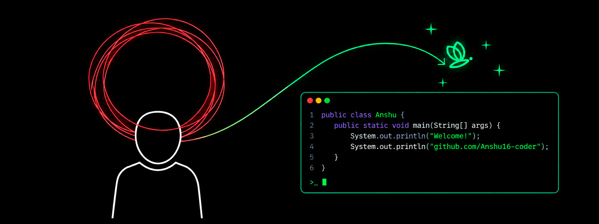

<p align="center">
  
</p>

<h1 align="center">
   Hey, I'm Anshu Kumar 👋
</h1>


## 👨‍💻 About Me

I'm a B.Tech Computer Science student at **Sitare University**, passionate about building scalable software and solving real-world problems.

```yaml
name: Anshu Kumar
role: CS Undergraduate
university: Sitare University
learning: [DSA, System Design]
interests: [Software Engineering, AI, Backend, Web]
goal: Software Engineering Internship
status: Open to opportunities 🟢
```

---

## 🛠 Tech Stack

<p align="center">
  
</p>

<p align="center">
  <b>Libraries:</b> Pandas • NumPy • BeautifulSoup • Matplotlib • TextBlob • VADER
</p>

---

## 🚀 Projects

<table>
  <tr>
    <td width="50%" valign="top">
      <h3>📌 Project One</h3>
      <p>One or two lines about what this project does and the problem it solves.</p>
      <p>
        
        
        
      </p>
      <a href="https://github.com/Anshu16-coder/YOUR-REPO-1">
        
      </a>
      <a href="https://your-live-demo-link.com">
        
      </a>
    </td>
    <td width="50%" valign="top">
      <h3>📌 Project Two</h3>
      <p>One or two lines about what this project does and the problem it solves.</p>
      <p>
        
        
        
      </p>
      <a href="https://github.com/Anshu16-coder/YOUR-REPO-2">
        
      </a>
      <a href="https://your-live-demo-link.com">
        
      </a>
    </td>
  </tr>
  <tr>
    <td width="50%" valign="top">
      <h3>📌 Project Three</h3>
      <p>One or two lines about what this project does and the problem it solves.</p>
      <p>
        
        
      </p>
      <a href="https://github.com/Anshu16-coder/YOUR-REPO-3">
        
      </a>
    </td>
    <td width="50%" valign="top">
      <h3>📌 Project Four</h3>
      <p>One or two lines about what this project does and the problem it solves.</p>
      <p>
        
        
      </p>
      <a href="https://github.com/Anshu16-coder/YOUR-REPO-4">
        
      </a>
    </td>
  </tr>
</table>

---

## 🏆 GitHub Achievements

<p align="center">
  
</p>

<p align="center">
  
</p>

---

## 🧩 LeetCode Progress

<p align="center">
  
</p>

---

## 💼 Open to Opportunities

I'm actively seeking **Software Engineering Internship** opportunities and enjoy collaborating on open-source projects and innovative software ideas.

📫 **Reach me:** [rajanshuman263@gmail.com](mailto:rajanshuman263@gmail.com) • [LinkedIn](https://www.linkedin.com/in/anshuyadavv)

<p align="center">
  
</p>
